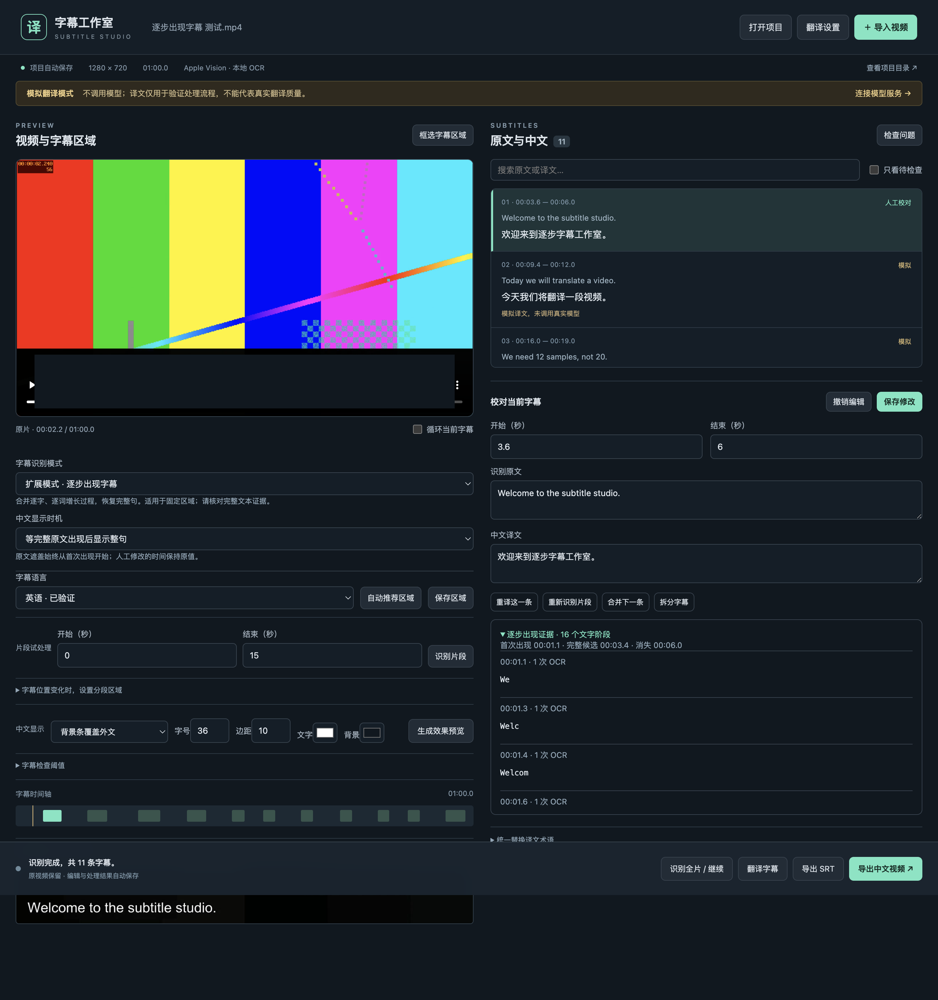

# 逐步出现字幕扩展模式

2026-10-01。独立分支 `codex/progressive-subtitles`，基线为 `main` / `7c45baa`。默认仍为标准模式，原标准应用包与 main 历史保留。Goal 提示词为根目录 `GOAL_PROGRESSIVE.md`。

## 范围与用法

扩展模式针对固定区域中逐字、逐词增加、最终清晰停留的硬字幕。选择“字幕识别模式 → 扩展模式 · 逐步出现字幕”，确认区域后识别。一次增长事件生成一条完整候选字幕，翻译只针对聚合结果，残句不单独送翻译。

可选择从原文首次出现显示整句中文，或等待完整文本主体出现后再显示整句；原字幕的遮盖时间独立保存，不随中文显示时机缩短。扩展模式对遮盖首尾各增加 200 ms 安全缓冲，补偿 OCR 采样边界，防止逐字初始字符或最后一帧外文闪回；这不改变识别指标和中文显示时间。手工改过起止时间的条目保留人工时间。

识别事件保留首次出现、完整候选首次观察、消失时间、各 OCR 文字阶段及代表图。完整候选需同一结果至少两次识别、跨度至少约 120 ms；确认后可回溯到相同完整文字主体首次被 OCR 读取的时间。末尾标点的 OCR 波动单独保留在证据里：`complete_evidence_text` 记录该帧实际读到的文字，不能用此处理删除 CER 中的标点错误。该时间属于离线恢复结果，不是实时推流时的预测。

缺乏稳定证据会标记待检查；增长事件末尾缺少结束标点也会提示确认完整性。无法从画面证明完整文本的内容不会由翻译模型补写。

两种模式各自保存字幕、检查点和人工修改。切换前保存正在编辑的内容；旧项目没有新增字段时默认标准模式。区域、语言、字体和翻译服务设置仍属于项目共享设置。保持原标准扫描函数的逻辑，新增引擎位于 `worker/progressive.py`。

本次不实现中文逐字动画、任意位置多气泡或特效文字识别；没有安装独立模型。翻译使用明确标注的 mock，真实 API/本地模型适配继续沿用原版本。

## 真实样本与指标

`tests/generate_progressive_fixture.py` 生成 60 秒、720p 的真实烧录视频 `artifacts/progressive-fixtures/逐步出现字幕 测试.mp4`。包含 11 个事件：逐字、逐词、增长中暂停、两行、直接换句、相同前缀新句、隔空白重复、数字及否定句；只有视频与音频轨道，文字不在可提取字幕轨道中。原文位置固定，并有变化背景。

参考标注只用于生成器与独立评估器，应用只读取视频像素。桌面识别原始结果在人工编辑前保存于 `artifacts/progressive-desktop-1790863263431/recognized.json`。

| 指标 | 逐步模式实测 | 目标 |
| --- | --- | --- |
| 字幕事件召回 | 11/11，100% | 100% |
| 误增事件 | 0 | 0 |
| CER | 0.6623% | ≤2% |
| 首次出现和消失均在 200 ms 内 | 11/11，100% | ≥95% |
| 完整主体时机在 200 ms 内，且有对应 OCR 证据 | 11/11，100% | ≥95% |
| OCR 调用次数 | 380 | 记录实测 |
| 扫描耗时（含取消前后有效处理） | 19.26 秒 | 无实时承诺 |

CER 仅进行 NFKC 和空白规范化，不移除数字、否定词、标点或其他错误。详细逐事件指标见 [ocr-metrics.json](progressive/ocr-metrics.json)。两个句子的末尾句点未被最终 OCR 读出，已计入 CER，并在应用中提示完整性核对。

标准模式也在扩展代码上完成真实桌面回归：13/13 事件、误增 0、CER 0.2907%、起止边界全部在 200 ms 内，与原基线一致。证据为 `artifacts/desktop-1790860990887/recognized.json` 和 [standard-regression.json](progressive/standard-regression.json)。另检查标准扫描函数 AST 与基线一致、原标准应用包的 worker 源文件与 main 相同。

## 桌面、恢复与导出证据

最终逐步桌面目录为 `artifacts/progressive-desktop-1790863263431/`。测试模式只替代文件选择器路径，实际 OCR、时间轴、worker、数据库、渲染和播放没有使用替身。

已实际操作：默认标准模式；切换扩展模式；增长中取消、重开；在标准模式识别片段并人工校对；切回逐步模式继续；保持活动事件 ID；恢复 11 个完整句；mock 翻译；显示时机切换；人工修改时间保护；模式来回切换与重开；合并、拆分、撤销和人工分段时间保护；缓存继续；原文增长证据展示；预览、SRT、MP4 导出及真实播放。



`result.json` 记录实际输出文件。`tests/verify_progressive_media.py` 从最终 MP4 解码画面，并在单独比较项目中生成“首次出现”策略短片，避免修改桌面验收项目。已检查：空白区间没有字幕；增长中的原文被覆盖；等待完整文本时不提前显示中文；首次出现策略能提前显示整句中文；完整句、两行、直接换句和相同前缀后一句正确显示。另逐项检查所有事件的真实首帧和末帧，验证原白色文字像素已被遮盖。输出 1280×720、H.264、音频存在、时长与输入相差不超过 50 ms。证据为最终目录下 `media-check/result.json`、`contact-sheet.jpg`，以及 `01-growth-editor.png`、`02-preview-playing.png`、`03-export-playing.png`。

## 检查与交付

- `npm test`：21 项通过。覆盖增长中暂停、短暂缺字、相同前缀重启、隔空白重复、数字/否定词改写、单帧异常、证据不足、状态序列化恢复、旧项目默认、模式结果隔离、显示策略与人工时间保护，以及原有回归。
- `npm run build`：TypeScript 检查与生产构建通过。
- `npm run test:desktop`：原标准桌面工作流通过。
- `npm run test:progressive`：扩展桌面工作流通过，无 renderer error。
- `npm run package`：生成独立的 `release-progressive/SubtitleStudioProgressive-darwin-arm64/SubtitleStudioProgressive.app`，原 `release/SubtitleStudio-darwin-arm64/SubtitleStudio.app` 保留。扩展版有独立应用 ID 和用户配置目录，支持与原标准版并存。
- 应用包兼容性检查：最终打包后实际打开旧标准项目（13 条）及新扩展项目（11 条），OCR 依赖可用，视频均真实播放通过。见 `artifacts/progressive-package-smoke.json` 和对应日志。

本地应用包仍沿用首版的开发环境限制：未签名、公证，Python 运行时依赖当前电脑；不承诺跨电脑无需准备依赖即可运行。

## 复现

```sh
npm ci
npm run setup
.venv/bin/python tests/generate_fixture.py
.venv/bin/python tests/generate_progressive_fixture.py
npm test
npm run build
npm run test:desktop
npm run test:progressive
# 将目录替换为桌面测试输出
.venv/bin/python tests/evaluate_progressive.py artifacts/progressive-desktop-1790863263431/recognized.json
.venv/bin/python tests/verify_progressive_media.py artifacts/progressive-desktop-1790863263431
npm run package
node tests/package-progressive.mjs
```

## 已知边界

上述指标只来自清晰英文合成样本，尚无用户真实视频验证。语句判断依赖文字增长、重启及多帧证据；连续显示两条完全相同的句子、且没有任何消失或重启画面时，无法从相同像素可靠区分。短暂漏读采用约 160 ms 的缓冲，极短真实空白也可能被平滑。完整文本只出现一帧、最终文本本就截断或 OCR 持续错误时，需要人工检查；标点缺失提示不等于完整性判定保证。其他语言与复杂滚动换行未专项验证，真实翻译质量仍需配置现有服务后检查。
